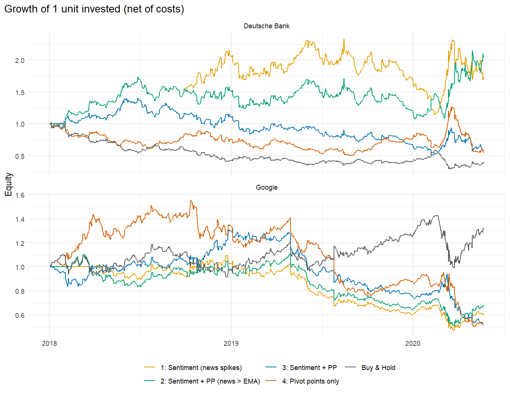
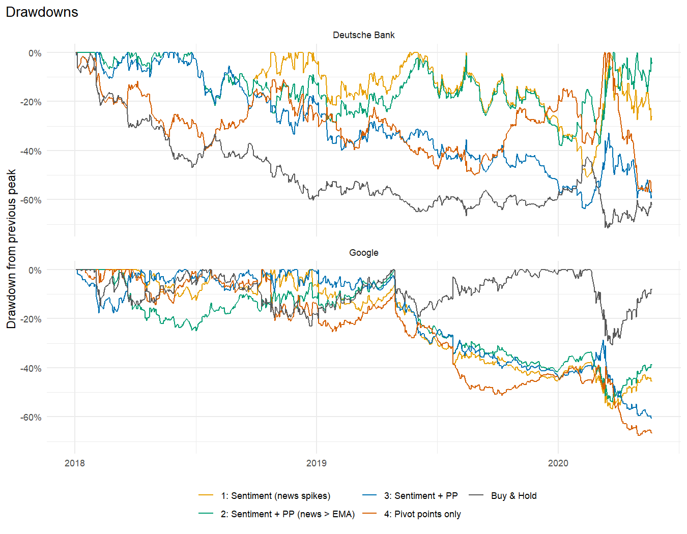
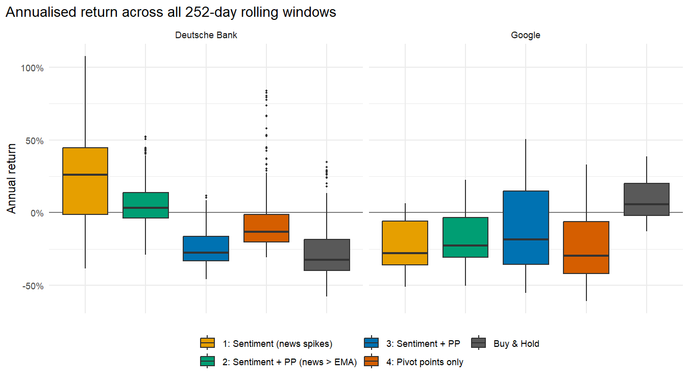
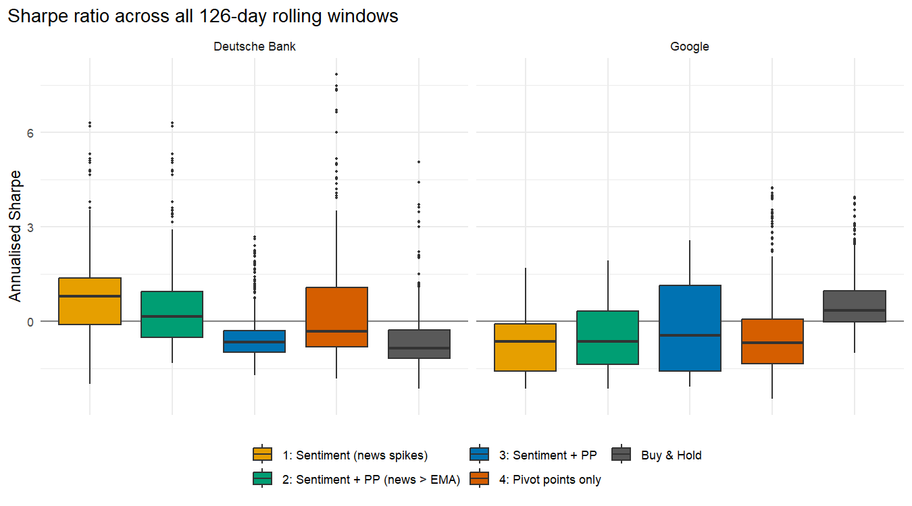
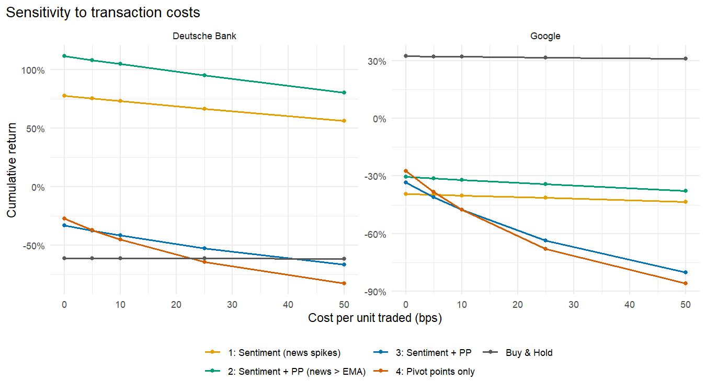
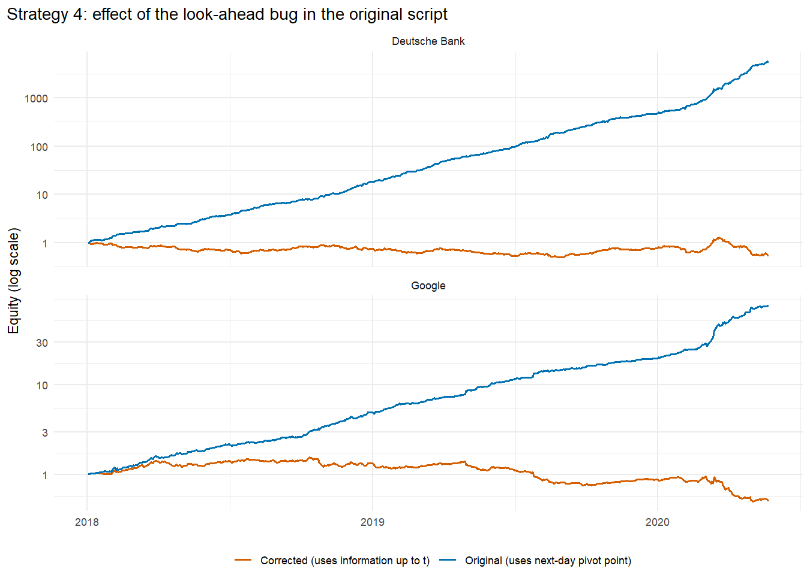

# Designing an automated trading strategy

Daily back-test of four rule-based trading strategies on **Deutsche Bank (DB)** and **Google (GOOG)**
(2018-01-02 → 2020-05-22, 602 trading days). The strategies combine:

* **Pivot points (PP)** – the classic pivot `PP = (High + Low + Close) / 3` compared with the open;
* **News sentiment** – a Bull/Bear ratio (`BBr`, 0–100) built from the positive/certainty/"fin-up" vs.
  negative/uncertainty/"fin-down" scores of daily news, and the relative volume of text (`RVT`, news flow).

> **Educational project. Not investment advice.** See [Conclusions](#conclusions) for what the results do – and do not – show.

## Strategies

| # | Name | Go long when… | Go short (or flat) when… |
|---|------|---------------|--------------------------|
| 1 | Sentiment (news spikes) | `RVT > 1.5·EMA(RVT)` and `BBr > 65` | `RVT > 1.5·EMA(RVT)` and `BBr < 35` |
| 2 | Sentiment + PP (news > EMA) | `RVT > EMA(RVT)`, `BBr > 65`, `Trend > 0` | `RVT > EMA(RVT)`, `BBr < 35`, `Trend < 0` |
| 3 | Sentiment + PP | `BBr > 50` and `Trend > 0` | `BBr < 50` and `Trend < 0` |
| 4 | Pivot points only | `Trend > 0.5 %` | `Trend < −0.5 %` |

`Trend = (PP − Open) / Open`. A position is **held until the opposite signal appears**. Strategy 4 has a
`size` (leverage) parameter that makes it as aggressive as desired.

**Timing (no look-ahead):** every signal uses information available at the close of day *t* and is
traded during day *t+1*. Returns are close-to-close on the adjusted close, net of a proportional cost of
10 bps per unit traded (entry, exit and reversals).

## Repository layout

```
R/strategies.R      signals, back-test engine and performance metrics (pure functions)
R/run_analysis.R    full analysis: back-tests, rolling windows, robustness checks, tables, figures
data/               DB.csv and GOOG.csv (local, git-ignored – see below)
results/            CSV tables and results/figures/*.png generated by the script
```

### Reproduce

```
Rscript R/run_analysis.R        # from anywhere; writes to results/
```

Requires R ≥ 4.x with the packages `TTR` and `ggplot2`. The input files `data/DB.csv` and
`data/GOOG.csv` are **not** tracked in git. Expected columns: an unnamed index column, `Date`, `Open`,
`High`, `Low`, `Close`, `Adj.Close`, `Volume`, `RVT`, `positivePartscr`, `negativePartscr`, `fearPartscr`,
`findownPartscr`, `finupPartscr`, `finhypePartscr`, `certaintyPartscr`, `uncertaintyPartscr`
(sentiment columns are `NA` on days without news).

## Results

Full period, net of 10 bps per unit traded (`results/metrics_full_period.csv`):

| | Sentiment (1) | Sent.+PP, news>EMA (2) | Sent.+PP (3) | PP only (4) | Buy & Hold |
|---|---:|---:|---:|---:|---:|
| **DB** cumulative return | **+73 %** | **+105 %** | −42 % | −45 % | −61 % |
| DB Sharpe (rf = 0) | 0.58 | 0.78 | −0.45 | −0.49 | −0.72 |
| DB max drawdown | −51 % | −38 % | −64 % | −57 % | −72 % |
| DB number of trades | 14 | 17 | 69 | 142 | 2 |
| **GOOG** cumulative return | −40 % | −32 % | −48 % | −48 % | **+32 %** |
| GOOG Sharpe | −0.65 | −0.49 | −0.76 | −0.76 | 0.39 |
| GOOG max drawdown | −57 % | −54 % | −61 % | −68 % | −31 % |
| GOOG number of trades | 8 | 12 | 122 | 164 | 2 |




**Rolling windows** (every 252-day window, step 1 day; `results/metrics_rolling_mean.csv`). Mean annual return:

| | 1 | 2 | 3 | 4 | Buy & Hold |
|---|---:|---:|---:|---:|---:|
| DB | +23 % | +6 % | −25 % | −7 % | −27 % |
| GOOG | −24 % | −17 % | −11 % | −24 % | +10 % |




### Robustness checks

* **First vs. second half** (`results/metrics_by_half.csv`). Only strategy 2 on DB is positive in both halves
  (+33 % and +54 %). Strategy 1 on DB earns +82 % in the first half and −5 % in the second. On GOOG,
  strategies 3 and 4 beat buy & hold in the first half (+23 % / +28 % vs. +11 %) and then lose 58–59 %
  in the second half (which contains the March-2020 crash).
* **Transaction costs** (`results/cost_sensitivity.csv`). Strategies 1 and 2 trade rarely (8–17 trades) and
  their DB results survive costs of up to 50 bps. Strategies 3 and 4 trade 70–160 times: their losses
  grow quickly with costs (strategy 4 on DB: −27 % at 0 bps, −82 % at 50 bps).
* **Leverage in strategy 4** (`results/strategy4_leverage.csv`). Leverage multiplies risk without
  creating edge: the Sharpe ratio stays negative and the cumulative return tends to −100 % at 5×.



## Conclusions

1. **The original results were an artefact of look-ahead bias.** The first version of the script computed
   the trend with `lag(PP, -1)`, which in `xts` is the *next* day's pivot point (it contains the next day's
   high, low and close). A position held during day *t+1* was therefore chosen knowing day *t+1*. With that
   bug, strategy 4 "turned" 1 unit into ≈5,600 (DB) and ≈76 (GOOG) in 2.4 years; with the corrected timing it
   loses about 45–48 %. This is the single most important finding.
   
2. **The previous claim that Sent_and_PP3/PP4 are the most profitable does not hold.** Once the bias is
   removed, the pivot-point-based strategies (3 and 4) are the worst on both stocks: they trade often, are
   very sensitive to costs and do not beat buy & hold.
3. **Strategies 1 and 2 (news-flow filter) look promising only on DB.** They trade rarely, act only when
   news volume rises and are the only ones that are profitable after costs (+73 % / +105 % vs. −61 %
   for buy & hold). But the evidence is weak: 14–17 trades, one stock, a result that is not stable across
   sub-periods for strategy 1, and DB fell ~60 % over the sample, which flatters any strategy able to go short.
   On GOOG, an up-trending stock in this sample, the same rules lose 32–40 % against +32 % for buy & hold.
4. **No strategy shows a robust edge across both assets.** With two assets, ~2.4 years and a crash in the
   sample, the results are consistent with noise. Parameters were fixed a priori (not optimised) precisely
   to avoid adding overfitting on top of this.
5. **Leverage is not a free lunch.** Raising `size` in strategy 4 only amplifies drawdowns.

### Limitations / ideas

* Only two assets and one regime; no out-of-sample validation on other periods or markets.
* Execution at the next close with a flat proportional cost; no slippage, borrowing cost for shorts or taxes.
* Sharpe ratios use a zero risk-free rate. Win rate is computed on days with a non-zero return.
* Next steps: more tickers, walk-forward parameter selection, statistical tests against random signals,
  position sizing by volatility.

## Changes with respect to the first version

* Fixed the look-ahead bias (above) and made the trend scale-free (`%` of the open instead of an absolute
  `0.2`, which was ≈2 % for DB but ≈0.02 % for GOOG).
* `RVT` no longer uses `na.approx` (which interpolates with *future* values); days without news now have `RVT = 0`.
* Strategy 4 now holds its position like the others; before, it defaulted to being long (size 5) whenever no
  signal fired.
* Costs are charged per change of position instead of subtracting a fixed amount from the final return.
* The four copy-pasted `RollingTestMAStrategy*` functions became one generic `rolling_performance()`;
  the EMA is computed once instead of in every loop iteration; debugging `print()` calls and
  the `rstudioapi`/absolute-path dependencies were removed; `foreach`, `doParallel`, `matrixStats`,
  `quantmod`, `xts` and `PerformanceAnalytics` are no longer needed.
* Variables `T` and `ts` (which shadow `TRUE` and `stats::ts`) were renamed.

## License

CC0 1.0 Universal – see [LICENSE](LICENSE).
